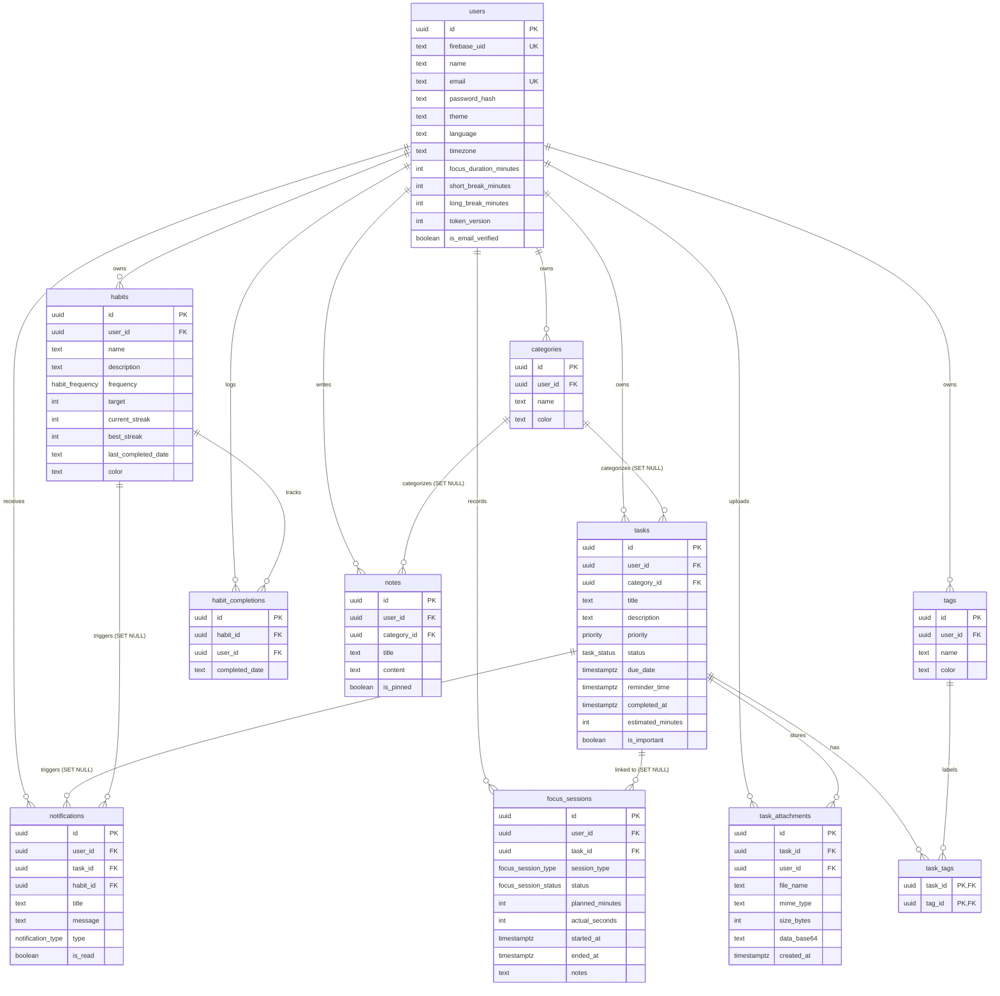

# API & Data Reference

All API endpoints are mounted under `/api` in `server/src/app.ts` and exchange JSON (`application/json`, `1mb` body limit). All data is persisted in PostgreSQL via Drizzle ORM (`src/db/schema.ts`).

## Database Schema

### Entity Relationship Diagram



### PostgreSQL Enums (`src/db/schema.ts`)

| Enum Name | Values |
| --- | --- |
| `priority` | `LOW`, `MEDIUM`, `HIGH` |
| `task_status` | `TODO`, `IN_PROGRESS`, `COMPLETED` |
| `habit_frequency` | `DAILY`, `WEEKLY`, `MONTHLY` |
| `focus_session_type` | `FOCUS`, `SHORT_BREAK`, `LONG_BREAK` |
| `focus_session_status` | `IN_PROGRESS`, `COMPLETED`, `CANCELLED` |
| `notification_type` | `TASK`, `HABIT`, `REMINDER`, `SYSTEM` |

### Constraints & Indexes

- Deleting a row in `users` cascades to all owned tables (`onDelete: "cascade"`). Deleting a `task` cascades to `task_tags` and `task_attachments`.
- Deleting a `category`, `task`, or `habit` sets optional foreign keys (`category_id`, `task_id`, `habit_id`) to `NULL` on dependent records (`onDelete: "set null"`).
- Unique indexes enforce uniqueness on `users(email)`, `users(firebase_uid)`, `categories(user_id, name)`, `tags(user_id, name)`, and `habit_completions(habit_id, completed_date)`.
- `task_tags` uses a composite primary key `(task_id, tag_id)`.
- `task_attachments` enforces application-level caps of **max 2 files per task**, **max 512 KB (`524,288` bytes) per file**, and a strict safe MIME allowlist (`image/png`, `image/jpeg`, `image/webp`, `image/gif`, `application/pdf`, `text/plain`, `text/markdown`, `text/csv`, `application/json`). Task listing queries hydrate attachment metadata only and omit `data_base64`.
- Note: The `notifications` table is provisioned in `src/db/schema.ts` for future reminders; no `/api/notifications` route is mounted yet.

---

## API Conventions

### Authentication & Rate Limiting

- Protected routes require `Authorization: Bearer <token>` (either a FocusFlow 7-day JWT or, when Firebase is configured, a Firebase ID token).
- General `/api` rate limit (`server/src/middlewares/rateLimit.middleware.ts`): **300 requests / 1 minute** (`2000` when `NODE_ENV=test`).
- Auth rate limit on `POST /api/users/register` and `POST /api/users/login`: **30 requests / 15 minutes** (`500` when `NODE_ENV=test`).
- AI rate limit on `POST /api/ai/decompose-task`: **15 requests / 1 minute** (`500` when `NODE_ENV=test`).

### Standard Response Envelopes

**Success:**

```json
{
  "success": true,
  "message": "Optional status message",
  "data": {}
}
```

*(For `POST /api/users/register` and `POST /api/users/login`, `user` and `token` are returned both inside `data` and at the top level for backward compatibility.)*

**Error (`server/src/middlewares/error.middleware.ts`):**

```json
{
  "success": false,
  "code": "VALIDATION_ERROR",
  "message": "Validation failed",
  "errors": {
    "title": ["Title is required"]
  }
}
```

Common error codes: `VALIDATION_ERROR` (`400`), `INVALID_ID` (`400`), `INVALID_REFERENCE` (`400`), `UNAUTHORIZED` (`401`), `SESSION_EXPIRED` (`401`), `FORBIDDEN` (`403`), `NOT_FOUND` (`404`), `CONFLICT` (`409`), `RATE_LIMITED` / `AI_RATE_LIMITED` (`429`), `INTERNAL_ERROR` (`500`), `AI_INVALID_RESPONSE` / `AI_UPSTREAM_ERROR` (`502`), `AI_SERVICE_UNAVAILABLE` (`503`).

---

## Endpoints

### Health

| Method | Path | Auth | Response |
| --- | --- | --- | --- |
| `GET` | `/api/health` | Public | `200` `{ success: true, data: { status: "ok" } }` |

### Users & Auth (`/api/users`)

Defined in `server/src/routes/user.routes.ts` and validated by `server/src/validators/user.validator.ts`.

| Method | Path | Auth | Request Body | Response |
| --- | --- | --- | --- | --- |
| `POST` | `/api/users/register` | Public (auth rate limit) | `{ name, email, password (min 8), timezone? }` | `201` `{ success, message, data: { user, token }, user, token }` |
| `POST` | `/api/users/login` | Public (auth rate limit) | `{ email, password }` | `200` `{ success, message, data: { user, token }, user, token }` |
| `POST` | `/api/users/logout` | Bearer | — | `200` `{ success, message }` (increments `token_version`) |
| `GET` | `/api/users/me` | Bearer | — | `200` `{ success, data: UserProfile }` |
| `PATCH` | `/api/users/me` | Bearer | `{ name?, theme? ("light"\|"dark"), language? ("en"\|"es"\|"fr"\|"de"), timezone?, focusDurationMinutes? (5–120), shortBreakMinutes? (1–30), longBreakMinutes? (5–60) }` | `200` `{ success, message, data: UserProfile }` |
| `GET` | `/api/users/:id` | Bearer (own ID only) | — | `200` `{ success, data: UserProfile }` (`403` for other user IDs) |

### Dashboard (`/api/dashboard`)

Defined in `server/src/routes/dashboard.routes.ts`.

| Method | Path | Auth | Query Params | Response |
| --- | --- | --- | --- | --- |
| `GET` | `/api/dashboard` | Bearer | `timezone?` (IANA string, default `"UTC"`) | `200` `{ success, data: { dateKey, overview, todayTasks, overdueTasks, upcomingTasks, unscheduledOpenTasks, habits, focusDailyHistory } }` |

`overview` contains: `openTasksCount`, `completedTodayCount`, `completedTasksTotal`, `overdueCount`, `dueTodayCount`, `habitsCompletedToday`, `habitsTotal`, `todayFocusMinutes`, `todayFocusSessions`, `weeklyFocusMinutes`.

### Tasks (`/api/tasks`)

Defined in `server/src/routes/task.routes.ts` and validated by `server/src/validators/task.validator.ts`.


| Method | Path | Auth | Request / Query | Response |
| --- | --- | --- | --- | --- |
| `GET` | `/api/tasks` | Bearer | Query: `status?` (`TODO`\|`IN_PROGRESS`\|`COMPLETED`), `priority?` (`LOW`\|`MEDIUM`\|`HIGH`), `categoryId?`, `tagId?`, `dueFilter?` (`all`\|`today`\|`overdue`\|`upcoming`\|`no_date`), `search?`, `sortBy?` (`createdAt`\|`dueDate`\|`priority`\|`updatedAt`\|`title`), `sortOrder?` (`asc`\|`desc`), `page?` (default `1`), `limit?` (1–100, default `50`), `timezone?` | `200` `{ success, data: Task[], pagination: { page, limit, total, totalPages } }` |
| `POST` | `/api/tasks` | Bearer | Body: `{ title, description?, status?, priority?, categoryId?, dueDate?, reminderTime?, estimatedMinutes? (1–1440), isImportant?, tagIds?: uuid[] }` | `201` `{ success, message, data: Task }` |
| `POST` | `/api/tasks/bulk` | Bearer | Body: `{ tasks: CreateTaskInput[] }` (1–20 tasks inserted atomically in one PostgreSQL transaction) | `201` `{ success, message, data: Task[] }` |
| `GET` | `/api/tasks/:id` | Bearer | — | `200` `{ success, data: Task }` |
| `PATCH` | `/api/tasks/:id` | Bearer | Body: partial fields from `POST /api/tasks` | `200` `{ success, message, data: Task }` |
| `PATCH` | `/api/tasks/:id/toggle` | Bearer | — | `200` `{ success, message, data: Task }` (toggles `COMPLETED` ↔ `TODO` and updates `completedAt`) |
| `DELETE` | `/api/tasks/:id` | Bearer | — | `200` `{ success, message }` |
| `POST` | `/api/tasks/:id/attachments` | Bearer | Body: `{ fileName (max 140), mimeType, dataBase64 }` (max 2 files/task, max 512 KB decoded, safe MIME allowlist; validated by `server/src/validators/attachment.validator.ts`) | `201` `{ success, message, data: TaskAttachmentMeta }` |
| `GET` | `/api/tasks/:id/attachments/:attachmentId/download` | Bearer | — | `200` Binary file stream with `Content-Type`, `Content-Disposition: attachment`, and `X-Content-Type-Options: nosniff` |
| `DELETE` | `/api/tasks/:id/attachments/:attachmentId` | Bearer | — | `200` `{ success, message }` |

### Habits (`/api/habits`)

Defined in `server/src/routes/habit.routes.ts` and validated by `server/src/validators/habit.validator.ts`.


| Method | Path | Auth | Request / Query | Response |
| --- | --- | --- | --- | --- |
| `GET` | `/api/habits` | Bearer | Query: `timezone?` (default `"UTC"`) | `200` `{ success, data: HabitWithHistory[] }` (includes `completedToday`, `currentStreak`, `bestStreak`, `recentDays`) |
| `POST` | `/api/habits` | Bearer | Body: `{ name, description?, frequency? ("DAILY"\|"WEEKLY"\|"MONTHLY"), target? (1–31), color? (#RRGGBB) }`; Query: `timezone?` | `201` `{ success, message, data: HabitWithHistory }` |
| `PATCH` | `/api/habits/:id` | Bearer | Body: partial fields from `POST /api/habits`; Query: `timezone?` | `200` `{ success, message, data: HabitWithHistory }` |
| `DELETE` | `/api/habits/:id` | Bearer | — | `200` `{ success, message }` |
| `POST` | `/api/habits/:id/check-in` | Bearer | Body: `{ date? ("YYYY-MM-DD"), timezone?, completed?: boolean }` | `200` `{ success, message, data: HabitWithHistory }` |

### Categories & Tags (`/api/categories`, `/api/tags`)

Defined in `server/src/routes/taxonomy.routes.ts` and validated by `server/src/validators/taxonomy.validator.ts`.

| Method | Path | Auth | Request Body | Response |
| --- | --- | --- | --- | --- |
| `GET` | `/api/categories` | Bearer | — | `200` `{ success, data: Category[] }` |
| `POST` | `/api/categories` | Bearer | `{ name (max 50), color? (#RRGGBB) }` | `201` `{ success, message, data: Category }` |
| `PATCH` | `/api/categories/:id` | Bearer | `{ name?, color? }` | `200` `{ success, message, data: Category }` |
| `DELETE` | `/api/categories/:id` | Bearer | — | `200` `{ success, message }` |
| `GET` | `/api/tags` | Bearer | — | `200` `{ success, data: Tag[] }` |
| `POST` | `/api/tags` | Bearer | `{ name (max 40), color? (#RRGGBB) }` | `201` `{ success, message, data: Tag }` |
| `PATCH` | `/api/tags/:id` | Bearer | `{ name?, color? }` | `200` `{ success, message, data: Tag }` |
| `DELETE` | `/api/tags/:id` | Bearer | — | `200` `{ success, message }` |

### Focus Sessions (`/api/focus`)

Defined in `server/src/routes/focus.routes.ts` and validated by `server/src/validators/focus.validator.ts`.

| Method | Path | Auth | Request / Query | Response |
| --- | --- | --- | --- | --- |
| `GET` | `/api/focus/overview` | Bearer | Query: `timezone?` (default `"UTC"`) | `200` `{ success, data: { todayFocusMinutes, todayFocusSeconds, todayCompletedSessions, weeklyFocusMinutes, dailyHistory, recentSessions } }` |
| `POST` | `/api/focus/sessions` | Bearer | Body: `{ taskId?, sessionType? ("FOCUS"\|"SHORT_BREAK"\|"LONG_BREAK"), plannedMinutes? (1–180), notes? }` | `201` `{ success, message, data: FocusSession }` |
| `PATCH` | `/api/focus/sessions/:id/complete` | Bearer | Body: `{ actualSeconds (0–86400), status? ("COMPLETED"\|"CANCELLED"), notes? }` | `200` `{ success, message, data: FocusSession }` |

### Notes (`/api/notes`)

Defined in `server/src/routes/note.routes.ts` and validated by `server/src/validators/note.validator.ts`.


| Method | Path | Auth | Request / Query | Response |
| --- | --- | --- | --- | --- |
| `GET` | `/api/notes` | Bearer | Query: `search?`, `categoryId?` | `200` `{ success, data: Note[] }` (pinned first, then newest updated) |
| `POST` | `/api/notes` | Bearer | Body: `{ title (max 140), content? (max 25000), categoryId?, isPinned? }` | `201` `{ success, message, data: Note }` |
| `GET` | `/api/notes/:id` | Bearer | — | `200` `{ success, data: Note & { detectedActions } }` |
| `PATCH` | `/api/notes/:id` | Bearer | Body: partial fields from `POST /api/notes` | `200` `{ success, message, data: Note }` |
| `DELETE` | `/api/notes/:id` | Bearer | — | `200` `{ success, message }` |
| `POST` | `/api/notes/:id/extract-tasks` | Bearer | Body: `{ selectedTitles?: string[], categoryId? }` | `201` `{ success, message, data: { extractedCount, tasks } }` |

### AI Task Decomposer (`/api/ai`)

Defined in `server/src/routes/ai.routes.ts`, validated by `server/src/validators/ai.validator.ts`, and backed by `@google/genai` (`server/src/lib/gemini.ts`, `server/src/services/ai.service.ts`).

| Method | Path | Auth | Request Body | Response |
| --- | --- | --- | --- | --- |
| `POST` | `/api/ai/decompose-task` | Bearer (AI rate limit) | `{ goal (5–300 chars), targetDate? ("YYYY-MM-DD" \| ISO datetime), autoCreate? (boolean, default false) }` | `200` (preview) or `201` (`autoCreate: true`) `{ success, data: { strategySummary, subtasks: [{ title, description, estimatedPomodoros (1–4), priority ("low"\|"medium"\|"high"), suggestedCategoryId (uuid\|null), suggestedDueDate ("YYYY-MM-DD") }], workspaceContext: { pendingTaskCount, categoriesCount, tagsCount }, createdTasks? } }` |
