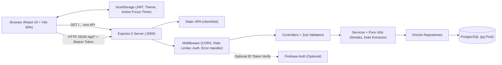
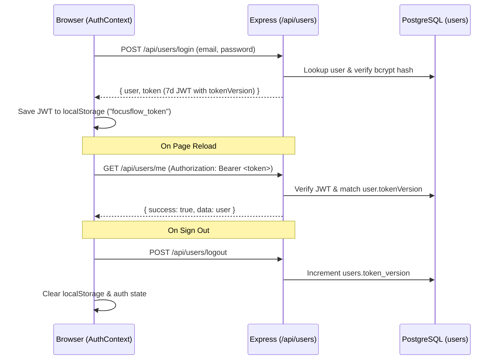

# Architecture

FocusFlow is a full-stack TypeScript productivity workspace organized as an npm workspaces monorepo (`client/` and `server/`) sharing a PostgreSQL data layer in `src/db/`.

## System Overview & Tech Stack

| Layer | Technologies | Key Files |
| --- | --- | --- |
| Frontend | React 19, TypeScript, Vite 8, React Router 7, Tailwind CSS 4 (`@tailwindcss/vite`), React Hook Form, Zod 4, Axios, Lucide icons | `client/src/App.tsx`, `client/vite.config.ts`, `client/src/lib/api.ts` |
| Backend API | Node.js (ESM), Express 5, TypeScript, Zod 4, `bcryptjs`, `jsonwebtoken`, `express-rate-limit`, `cors` | `server/src/app.ts`, `server/src/server.ts` |
| Optional OAuth | Firebase Auth client SDK (`firebase/auth`) + `firebase-admin` server ID token verification (dynamically enabled only when configured) | `client/src/lib/firebase.ts`, `server/src/lib/firebase-admin.ts` |
| Database | PostgreSQL via `pg.Pool` and Drizzle ORM (`drizzle-orm/node-postgres`, `drizzle-kit`) | `src/db/schema.ts`, `src/db/index.ts`, `src/db/drizzle.config.ts` |
| Testing | Node built-in test runner (`node:test`) executed with `tsx` | `server/src/tests/*.test.ts`, `client/src/utils/focusTimer.test.ts` |

## System Architecture Diagram



## Folder Structure

```text
.
├── client/                     # React 19 + Vite SPA workspace
│   ├── index.html              # HTML entry point & fonts
│   ├── vite.config.ts          # Vite + Tailwind v4 + /api dev proxy
│   └── src/
│       ├── App.tsx             # Route table & ProtectedWorkspace wrapper
│       ├── context/            # AuthContext (session restore, theme sync, logout)
│       ├── lib/                # Axios client + interceptors, optional Firebase init
│       ├── components/         # AppLayout shell, ProtectedRoute, TaskFormModal, UI primitives
│       ├── features/           # Domain types, Zod form schemas, and API service clients
│       │   ├── auth/
│       │   ├── dashboard/
│       │   ├── focus/
│       │   ├── habits/
│       │   ├── notes/
│       │   └── tasks/
│       ├── pages/              # Route views (Auth, Dashboard, Tasks, Habits, Focus, Notes, Settings)
│       └── utils/              # Date formatting & timestamp-based Focus Timer state machine
├── server/                     # Express 5 + TypeScript API workspace
│   ├── tsconfig.json           # Compiles server/src and ../src/db into server/dist
│   └── src/
│       ├── server.ts           # HTTP listener on 0.0.0.0:$PORT (default 3000)
│       ├── app.ts              # Express app, CORS, security headers, API mounts, SPA serving
│       ├── lib/                # Env validation, AppError factories, optional Firebase Admin
│       ├── middlewares/        # Auth (JWT + optional Firebase), rate limiting, error handling
│       ├── routes/             # Express routers mounted under /api/*
│       ├── controllers/        # HTTP request parsing & JSON response envelopes
│       ├── validators/         # Zod request body & query schemas
│       ├── services/           # Business rules, ownership verification, aggregations
│       ├── repositories/       # Drizzle ORM PostgreSQL queries
│       ├── utils/              # JWT signing/verification, streak engine, note task extractor
│       └── tests/              # Pure logic unit tests & live PostgreSQL integration tests
├── src/
│   └── db/                     # Shared Drizzle PostgreSQL layer
│       ├── schema.ts           # 10 PostgreSQL tables, enums, indexes, and Drizzle relations
│       ├── index.ts            # Lazy global pg.Pool (Cloud SQL discrete vars or DATABASE_URL)
│       └── drizzle.config.ts   # Drizzle Kit schema push/migration config
├── shared/
│   └── types/                  # Shared API contract type definitions
└── docs/                       # Project documentation and UI screenshots
```

## Core Application Routes

Defined in `client/src/App.tsx`:

- **Public-only routes** (`PublicOnlyRoute` redirects authenticated users to `/dashboard`): `/login`, `/register`
- **Protected workspace routes** (`ProtectedRoute` + `AppLayout` sidebar/mobile drawer): `/dashboard`, `/tasks`, `/habits`, `/focus`, `/notes`, `/settings`
- Fallback routes (`/` and `*`) redirect to `/dashboard`.


## Data Flow & Key Design Patterns

### 1. Layered Backend Separation
Every API endpoint follows the flow `routes → middlewares → controllers → validators (Zod) → services → repositories (Drizzle) → PostgreSQL`. All errors flow into `server/src/middlewares/error.middleware.ts`, which translates `ZodError` (`400`), `AppError` (custom status/code), and PostgreSQL error codes (`23505` → `409`, `22P02` → `400`, `23503` → `400`) into consistent JSON without exposing stack traces.

### 2. Authentication & Session Lifecycle



- **Token revocation**: `POST /api/users/logout` increments `users.token_version` so previously issued JWTs are immediately rejected by `server/src/middlewares/auth.middleware.ts`.
- **Optional Google Sign-In**: When `firebase-applet-config.json` or `VITE_FIREBASE_*` / `FIREBASE_PROJECT_ID` is configured, `client/src/lib/firebase.ts` and `server/src/lib/firebase-admin.ts` enable Google Sign-In via popup. Firebase ID tokens are stored only in memory (`inMemoryToken` in `client/src/lib/api.ts`), verified server-side, and upserted into `users`. When unconfigured, the server boots cleanly and the UI hides the Google Sign-In button.
- **Unauthorized interceptor**: Any non-auth `401` response clears tokens and triggers `AuthContext`'s unauthorized handler.

### 3. Wall-Clock Focus Timer Persistence
`client/src/utils/focusTimer.ts` persists active session state under `localStorage` key `focusflow_active_timer_v1` using epoch timestamps (`targetEndAt`, `sessionStartedAt`, `segmentStartedAt`) and `accumulatedSeconds`. Remaining and elapsed seconds are computed from `Date.now()` rather than counting interval ticks, preventing drift across background tabs and full page reloads.


### 4. Pure, Unit-Tested Domain Engines
- **Habit streak calculation** (`server/src/utils/streak.ts`): Computes `currentStreak` and `bestStreak` from deduplicated `YYYY-MM-DD` completion keys in the user's IANA timezone, preserving an active streak through yesterday if today has not yet been checked in.
- **Deterministic note action extraction** (`server/src/utils/noteExtractor.ts`): Parses unchecked Markdown checkboxes (`- [ ]`), `TODO:` / `ACTION:` prefixes, and bullet action lines into deduplicated task drafts without calling external LLM APIs.
